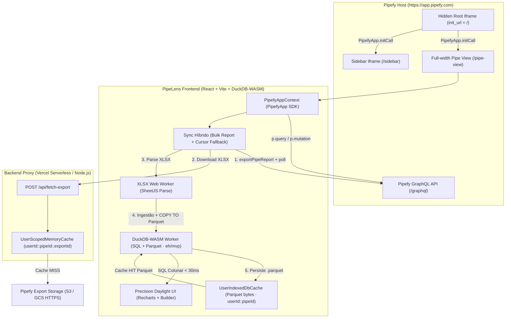
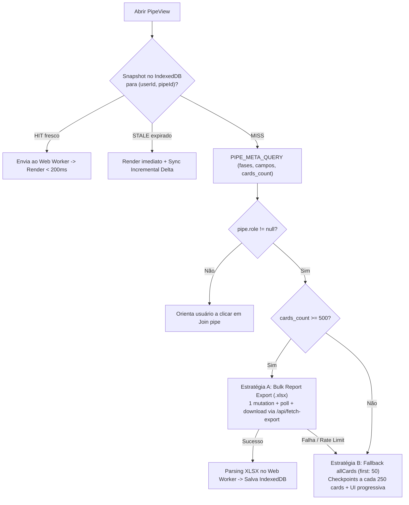

# Arquitetura da Solução — PipeLens Dashboard (Case 1)

Este documento detalha as decisões arquiteturais, trade-offs, estratégia para lidar com **20.000 cards**, modelo de **cache isolado por usuário**, segurança e limitações conhecidas do aplicativo **PipeLens Dashboard** construído com o **Pipefy Apps SDK**.

---

## 1. Visão Geral da Arquitetura

O PipeLens executa embarcado diretamente na interface do Pipefy através de iframes (`pipe-view` e `sidebar` acionada via `pipe-buttons`), autenticando-se automaticamente no contexto da sessão do usuário logado sem exigir tokens estáticos ou credenciais OAuth manuais.

---

## 2. Volume e Desempenho: Por que Sincronização Híbrida para 20.000 Cards?

A API GraphQL do Pipefy impõe três limites operacionais relevantes para grandes volumes:

| Limite da API Pipefy | Valor | Impacto em 20.000 Cards |
| :--- | :--- | :--- |
| Tamanho máximo de página (`allCards`) | **50 cards/requisição** | Exigiria **400 chamadas sequenciais** (~40–90 segundos e alto risco de throttling/timeout) |
| Complexidade máxima por query | **50.000 pontos** | Queries profundas com muitos subcampos em listas estouram facilmente o orçamento |
| Timeout por requisição | **33 segundos** | Consultas pesadas sem paginação enxuta falham |
| Rate limit de Exportação de Relatórios | **50 exports / 24h / pipe** | Exige cache local persistente e proteção contra re-exports repetidos |

### Fluxo Híbrido Adotado (`src/sdk/pipefySync.ts`)

### Motor Analítico DuckDB-WASM & Web Workers (`src/db/` e `src/workers/xlsx.worker.ts`)

- **Parsing de `.xlsx` fora da Main Thread:** planilhas de 20.000 linhas em `SheetJS` são transferidas via `ArrayBuffer` (`Transferable`) para `xlsx.worker.ts`, evitando qualquer congelamento de scroll ou clique na interface do Pipefy.
- **Execução SQL Colunar no DuckDB-WASM (`src/db/duckdbEngine.ts`):**
  - Utiliza exclusivamente os bundles **single-thread** (`duckdb-eh.wasm` / `duckdb-mvp.wasm`) dentro do Web Worker oficial do DuckDB, evitando dependência de `SharedArrayBuffer` / headers `COOP`+`COEP` que falhariam dentro do iframe cross-origin do Pipefy (`app.pipefy.com`).
  - **Catálogo Dinâmico Tipado (`src/db/schemaCatalog.ts`):** gera `CREATE TABLE cards (...)` dinamicamente a partir de `pipe.start_form_fields` (`number` → `DOUBLE`, `boolean` → `BOOLEAN`, demais → `VARCHAR`), validando identificadores contra *whitelist* e escapando parâmetros literais para impedir SQL Injection.
  - **Consultas Analíticas & Paginação Server-like:** filtros (`WHERE`), agregações (`COUNT`, `SUM`, `AVG`, `MEDIAN`, `MIN`, `MAX`, `DISTINCT`), bucketing temporal (`DATE_TRUNC` / `strftime`), histogramas numéricos e paginação (`ORDER BY ... LIMIT 50 OFFSET ...`) rodam em SQL vetorizado no Worker, trafegando apenas os buckets agregados ou a página atual para a interface React.

---

## 3. Estratégia de Hospedagem e Cache com Isolamento por Usuário

### Hospedagem
- **Produção (Cloud):** hospedado em **Vercel** (build estático Vite + Serverless Functions `/api/fetch-export` e `/api/health` em Node.js), com cabeçalhos configurados em `vercel.json` para permitir iframe em `https://app.pipefy.com` (`Content-Security-Policy: frame-ancestors https://app.pipefy.com https://*.pipefy.com 'self'`, sem `X-Frame-Options` restritivo, e CORS habilitado).
- **Execução Local:** servidor Node.js unificado (`server/index.mjs`) servindo o bundle compilado `dist/` e o endpoint `/api/fetch-export` na porta `4173`, facilmente exposto via `cloudflared` (`npm run tunnel`) para validação dentro do Pipefy.

### Cache em 3 Camadas com Separação Estrita por Usuário

1. **Identidade Canônica do Usuário:** no boot dentro do Pipefy, o `PipefyAppContext` executa `p.query('{ me { id name email username } }')`. Nenhum cache é gravado sem um `userId` explícito.
2. **Camada 1 — IndexedDB com Parquet Comprimido (`src/cache/userIndexedDb.ts`):**
   - Banco `pipefy_pipelens_cache_v1` com stores `snapshots` e `views`.
   - Os 20.000 cards são exportados pelo próprio DuckDB-WASM para **Apache Parquet** (`COPY cards TO ... (FORMAT PARQUET)`), reduzindo o snapshot de ~13,6 MB (JSON v1) para **~1–2 MB** binários colunares, com upgrade transparente de registros v1 legados para Parquet.
   - Chave composta obrigatória: `${userId}::${pipeId}` + validação dupla `record.userId === userId` na leitura e na limpeza.
   - Limpar o cache (`clearUserCache(userId)`) remove exclusivamente os registros indexados pelo `userId` solicitante.
   - Política **Stale-While-Revalidate** com TTL configurável (padrão: 15 minutos).
3. **Camada 2 — Cache LRU em Memória no Proxy (`/api/fetch-export` & `server/userCache.mjs`):**
   - Porque os links pré-assinados (`fileURL`) gerados pelo `pipeReportExport` podem ter restrição CORS para `fetch` direto no browser, o app busca o binário pelo próprio backend (`/api/fetch-export`).
   - O servidor mantém um `UserScopedMemoryCache` (máx. 24 entradas, TTL 10 min) indexado por `${userId}::${pipeId}::${exportId}`. Um usuário `B` nunca recebe cache em memória gerado pelo usuário `A`.
4. **Camada 3 — Estado Privado no Pipefy SDK (`p.set('pipe', 'private', ...)`):**
   - As visões configuradas pelo usuário também são persistidas no escopo privado do Pipefy quando abaixo do limite seguro de tamanho, acompanhando o usuário entre sessões.

---

## 4. Segurança e Boas Práticas Aplicadas

- **Zero Credenciais Hardcoded:** toda leitura/escrita no Pipefy ocorre exclusivamente via `p.query()` e `p.mutation()`, herdando exatamente as permissões do usuário autenticado na interface do Pipefy.
- **Proteção Anti-SSRF no Proxy (`/api/fetch-export`):** `validateExportUrl()` aceita apenas protocolo `https:` e hostnames terminados em `.amazonaws.com`, `.pipefy.com`, `.staticpipefy.com` ou `.storage.googleapis.com`, além de impor timeout de 25s e limite de payload de 25 MB.
- **Proteção de Rate Limit:** cooldown local de 90s antes de disparar um novo `exportPipeReport` automático, preservando a cota diária de 50 exports por pipe.
- **Acessibilidade e Ergonomia Web:** uso de `<dialog>` nativo (`showModal()`, `overscroll-behavior: contain`, fechamento por `Esc`), tabelas semânticas com cabeçalhos `position: sticky`, tipografia tabular (`tabular-nums`) para métricas financeiras e respeito a `prefers-reduced-motion`.

---

## 5. Limitações Conhecidas e Evolução Futura

1. **Limite de 30.000 cards no Pipe Reports Export:** para pipes com mais de 30k cards, a evolução recomendada é particionar o relatório por faixas de `created_at` usando `createPipeReport` com filtros de período ou introduzir um backend de ingestão contínua via Webhooks (`card.create`, `card.move`, `card.field_update`, `card.delete`) persistido em PostgreSQL/ClickHouse.
2. **Eventos `onCardUpdated` do SDK:** conforme a documentação oficial do Pipefy Apps SDK, o evento `PipefyApp.registerListener('onCardUpdated')` dispara em alterações de `due_date`, não em edições arbitrárias de campos. Por isso o PipeLens combina os listeners com o botão **Atualização Incremental (Delta)** e checagem de contagem ao abrir/revalidar.
3. **Cache LRU Serverless em Memória:** em ambientes serverless (como Vercel), o cache em memória da função pode sofrer *cold start* entre invocações distribuídas; a persistência principal e imediata por usuário é garantida no **IndexedDB** do navegador (e, em produção multi-dispositivo, o LRU em memória pode ser facilmente trocado por Redis/Vercel KV com o mesmo contrato de chave `user:{id}:pipe:{pipeId}`).
